<!-- Generated by scripts/render_cards.py. Edit profile.json, not this file. -->

 
 
 
 
<picture><source media="(prefers-color-scheme: dark)" srcset="./cards/title-coding-dark.svg" /></picture> 

<a href="https://krishkunjadiya.vercel.app/">portfolio</a> &nbsp;/&nbsp; <a href="https://linkedin.com/in/krishkunjadiya3085">linkedin</a> &nbsp;/&nbsp; <a href="https://github.com/Krish-kunjadiya?tab=repositories">github</a> &nbsp;/&nbsp; <a href="https://www.kaggle.com/krishkunjadiya">kaggle</a> &nbsp;/&nbsp; <a href="https://leetcode.com/u/KrishKunjadiya/">leetcode</a>

